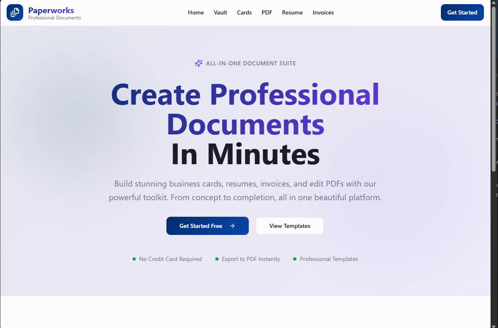
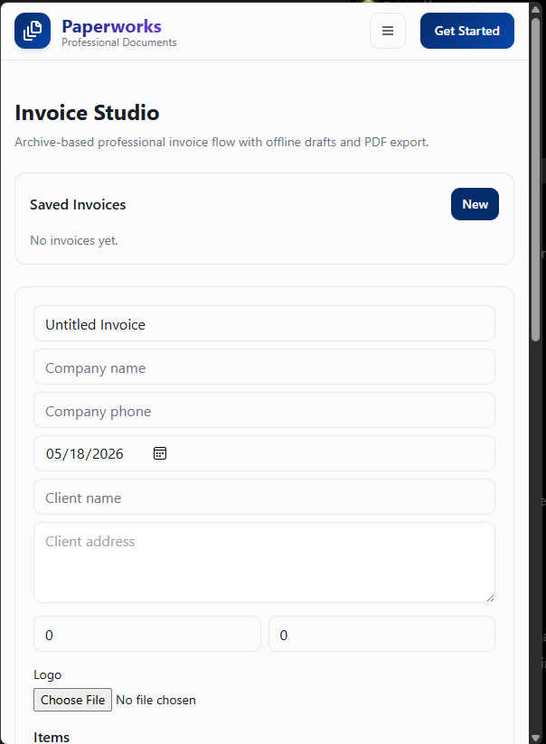
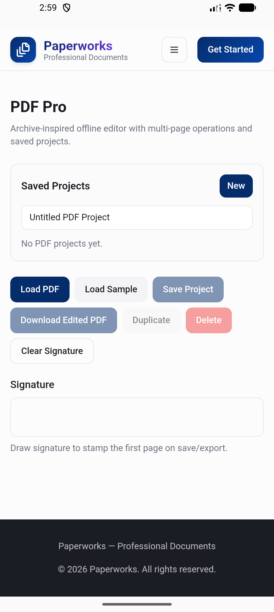

# Paperworks

**Live demo:** https://robfernan.github.io/Paperworks/

**Paperworks** is a free, offline-first document and business automation suite. Create invoices and proposals, ATS-friendly resumes, and print-ready business cards, and mark up PDFs — in the browser, with no account and no file upload.

**Web is live.** Native desktop and mobile packaging is in progress (**coming soon**).

[](https://robfernan.github.io/Paperworks/)
[](https://robfernan.github.io/Paperworks/)
[](https://robfernan.github.io/Paperworks/)
[](https://robfernan.github.io/Paperworks/)
[](https://bun.sh)
[](https://react.dev/)
[](https://www.typescriptlang.org/)
[](./LICENSE)

If Paperworks is useful, a [star](https://github.com/robfernan/Paperworks) helps other people find it.

---

## Preview

These captures are the **live web app**. Native desktop and mobile builds are not released yet.

<p>
  
</p>

| Invoice Studio | PDF Pro |
| --- | --- |
|  |  |

---

## Overview

**Paperworks** is a document workstation that runs **offline in the browser, with no cloud account and no remote telemetry**. It includes visual layout tools, Word `.docx` export, print-ready PDFs, and PDF annotation.

The **web app is live**, including an installable PWA: [open the demo](https://robfernan.github.io/Paperworks/). Native **desktop** (Wails) and **mobile** (Capacitor) packaging is in progress and **coming soon** — those apps are not shipped yet.

Documents are compiled in the browser with `pdf-lib` and `jsPDF`, instead of being uploaded to a third-party PDF service.

---

## Privacy

| Principle | How Paperworks protects you |
| :--- | :--- |
| **Local processing** | PDF manipulation, text extraction, and invoice calculations run on your device. |
| **Local storage** | Invoices, resume drafts, and business cards persist in browser `IndexedDB`. Native filesystem storage (`data/blobs`) is part of desktop packaging, which is coming soon. |
| **Data you can take with you** | JSON backup export and import moves the vault without a vendor account. |
| **Flattened PDFs** | Signed and stamped documents can be flattened into the page so the marks stay on the file. |

---

## Feature suites

### Invoice & proposals
* **Service and product catalog:** Save preset goods and services with SKUs, descriptions, and default rates for one-click line items.
* **Multi-currency:** Switch among `$`, `€`, `£`, `¥`, `CHF`, `C$`, `A$`, and `₹`.
* **Deposits and balance:** Log partial payments, tax rates, and discounts with a live balance due.
* **PDF and Word export:** Print-ready PDFs and editable `.docx` files with financial tables.

### PDF annotation
* **In-browser engine:** Page work runs locally with `pdf-lib` and `jsPDF`.
* **Markup:** Checkmarks, rectangles, highlights, circles, and notes, with opacity controls.
* **Signature pad:** Draw or type a signature and reuse it from a local signature vault.
* **Stamps:** `APPROVED`, `CONFIDENTIAL`, `VOID`, and `FINAL DRAFT`.
* **Page tools:** Reorder, rotate (90°), and extract pages.

### Resumes
* **Single-column layouts** aimed at applicant tracking systems.
* **Type styles:** Modern sans (Inter), executive serif (Georgia/Times), and technical mono (Courier).
* **Themes:** Modern Sky, Classic Slate, Executive Blue, Minimalist Mono, and Forest Emerald.
* **PDF and Word export.**

### Business cards
* **Print bleed:** Commercial 3.75" × 2.25" sheets with corner crop marks and a 0.125" safety margin.
* **Nudge controls:** Small X/Y adjustments with snap-to-grid alignment.
* **Stock finishes:** Studio White, Bone Stock Ivory, Eggshell Linen, Obsidian Luxury, and Brushed Platinum.

### Document vault
* Point-in-time snapshot timeline for undo and redo.
* Searchable archive of created documents, with backup and restore.

---

## Comparison

| Capability | **Paperworks** | **Canva Pro** | **Adobe Acrobat Pro** | **Smallpdf** |
| :--- | :--- | :--- | :--- | :--- |
| **Price** | **Free (MIT)** | Paid subscription | Paid subscription | Paid subscription |
| **Where files are processed** | **On your device** | Cloud upload | Adobe cloud | Cloud upload |
| **PDF annotation and sign** | **Included** | Limited | Yes | Limited |
| **Resume builder** | **Included (.docx + PDF)** | Design-heavy layouts | None | None |
| **Itemized invoices** | **Included (.docx + PDF)** | Basic templates | None | None |
| **Commercial print bleed** | **Included (0.125")** | Pro only | InDesign | None |
| **Command palette (⌘K)** | **Included** | None | None | None |

---

## Architecture

```
┌─────────────────────────────────────────────────────────────────────────────┐
│                       Paperworks Presentation Layer                         │
│       React 18  •  TypeScript  •  Tailwind CSS  •  shadcn-ui Components      │
└──────────────────────────────────────┬──────────────────────────────────────┘
                                       │
┌──────────────────────────────────────▼──────────────────────────────────────┐
│                  Unified Document Core & Command Engine                     │
│   • Universal Command Palette (Ctrl+K / ⌘K)                                 │
│   • Deep Undo/Redo Transaction History (Ctrl+Z / Ctrl+Y)                    │
│   • Autosave Snapshot Timeline (IndexedDB v3 Stores)                        │
└──────────────────────────────────────┬──────────────────────────────────────┘
                                       │
┌──────────────────────────────────────▼──────────────────────────────────────┐
│                    Platform Storage Bridge Abstraction                      │
│                           (src/lib/platformBridge.ts)                       │
├───────────────────────────────┬───────────────────────────────┬─────────────┤
│ Desktop · coming soon         │ Mobile · coming soon          │  Web · live │
│ Wails packaging, in progress  │ Capacitor packaging           │  IndexedDB  │
│ (not released yet)            │ (not released yet)            │  blob store │
└───────────────────────────────┴───────────────────────────────┴─────────────┘
```

The web build is the released product. Wails and Capacitor adapters in this repository are packaging work, not shipped apps.

---

## Quick start

```bash
# Clone repository
git clone https://github.com/robfernan/Paperworks.git
cd Paperworks

# Install dependencies with Bun
bun install

# Start local Vite development server
bun run dev

# Build production bundle
bun run build
```

Or skip the clone and use the [live demo](https://robfernan.github.io/Paperworks/).

---

## License

Licensed under the **MIT License**. See [LICENSE](./LICENSE).
